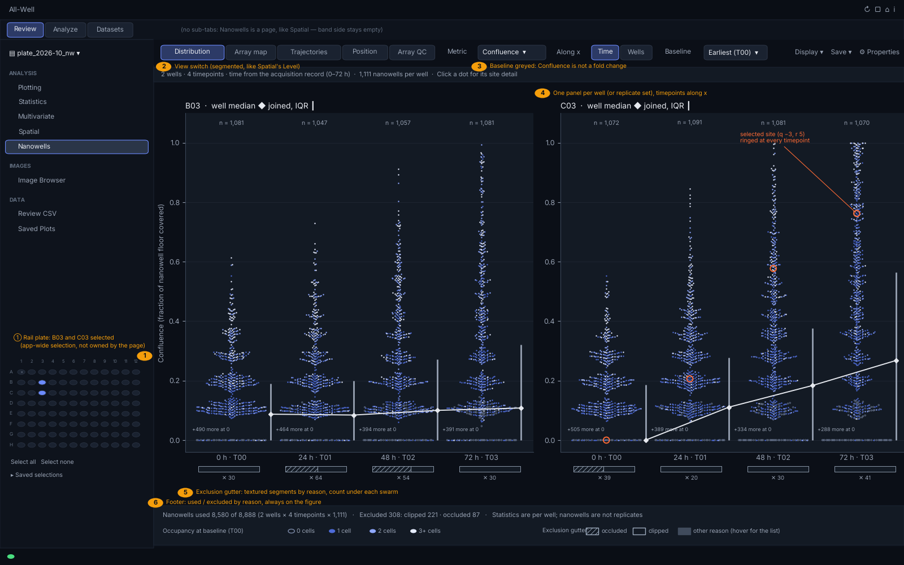
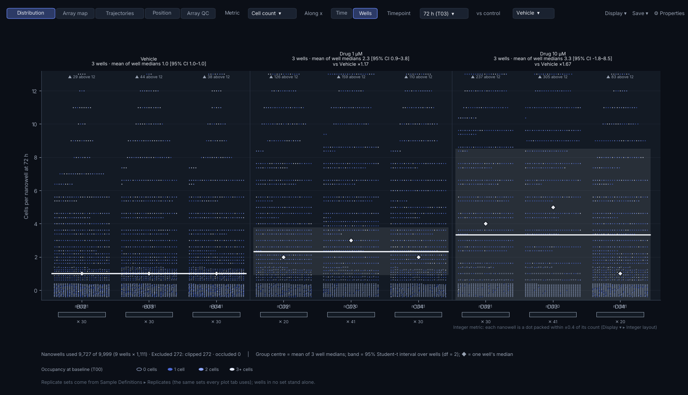
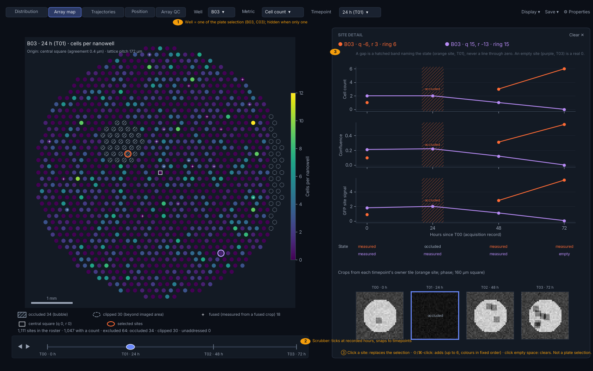
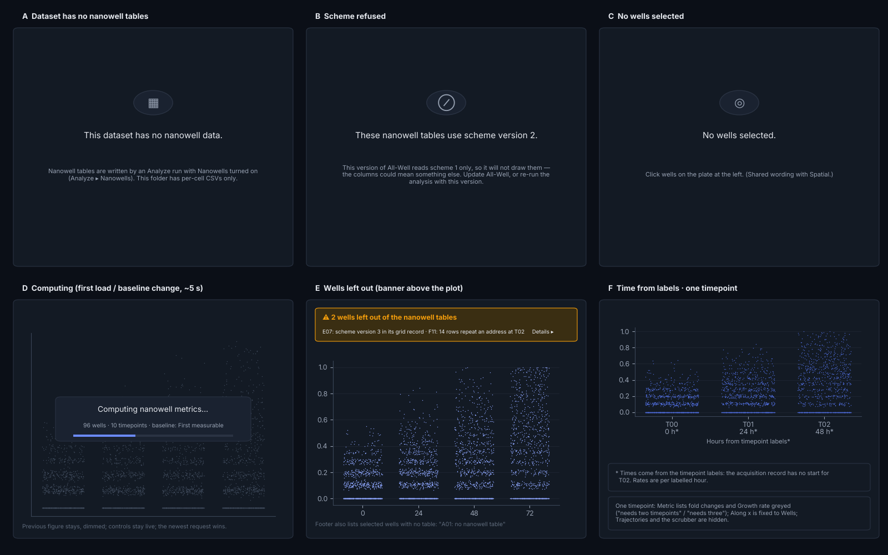
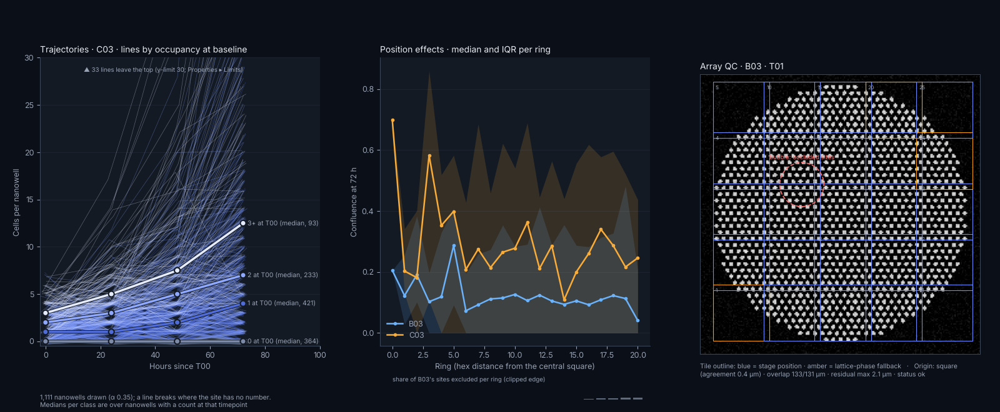

# The Nanowells page — interface plan

**Status:** a plan, written before any code exists. It covers tracker Section V
(`_Docs/Markdowns/NANOWELL_TRACKER.md`). The tracker's §3.10.3 is the source of intent;
where this plan departs from it, the departure is listed in §6 as a question for the
owner, with a recommended answer. **The owner accepted every recommended answer in §6.1
(Q1–Q13).** The tracker's §3.10.3 records the decisions, and the Section V rows carry
the splits and new rows of §6.4. Where this plan and the tracker disagree, the tracker
wins.

**Read against:** branch `claude/nanowell-9-review` (the Section D data layer,
`review/features/nanowell/`). Every number this page draws comes from
`series_compute.site_metrics`, `series_compute.exclusion_reason`,
`summary_compute.well_summary` and `summary_compute.group_summary`. Nothing in this
plan redesigns those. Where the page needs something they do not provide, it is
listed as a gap (§6.3), not designed around.

**Wireframes** are in this folder, drawn with matplotlib from synthetic data (the
throwaway generator is not kept): 1,111 nanowells per well on a 172 µm hexagonal lattice, nine wells, four
timepoints (0, 24, 48 and 72 h), a bubble that occludes a block of sites at some
timepoints, and a clipped edge on one side of every array. Colours are read from
`ui/theme.py` at run time, apart from the proposed occupancy ramp (§5.1), which is
new. The wireframes show layout and encoding. They are not pixel specifications.

---

## 1. Who does what

The users are biologists running time-lapse assays on nanowell arrays. They arrive
with a dataset that has already been analysed in nanowell mode. These are the
tasks they bring to the page, ranked by how often they come up and how much rests
on the answer.

| Rank | Task | The question in the user's words | Shortest path |
|---|---|---|---|
| 1 | **Read growth in one condition over time** | "Did the cells in these nanowells grow, and how spread out is it?" | Select the wells on the rail plate, then open **Nanowells** on the rail. The default view (Distribution, timepoints along x, metric Cell count) is the answer. No further clicks. |
| 2 | **Compare conditions at a timepoint** | "Does the drug change growth compared with vehicle?" | From the default, click **Along x: Wells**, pick the **Timepoint**, and pick a fold-change **Metric** if wanted. Replicate sets come from Sample Definitions without any action on this page. Two or three clicks. |
| 3 | **Check whether a well can be trusted** (bubbles, edge effects, misregistration) | "Is that low median real, or is half the array under a bubble?" | The exclusion gutter and footer on the default view already say how many sites were lost and why. For *where*, switch to **Array map** (one click) and scrub time. For *why*, **Array QC**. For edge effects, **Position**. |
| 4 | **Follow one nanowell** | "What happened in this nanowell? Show me the cells." | Click its dot (Distribution) or its site (Array map). Site detail opens at the right with its values over time and its crop at each timepoint. One click. |
| 5 | **See fates by starting occupancy** | "Do nanowells seeded with one cell grow differently from those seeded with three?" | **Trajectories** (one click). Lines are coloured by occupancy at baseline, and there is one median line per class. |
| 6 | **Take the numbers elsewhere** | "I want to run my own statistics." | **Save ▾ → Save nanowell data…** writes the long-format CSV (tracker D8). **Save ▾ → Save plot data…** writes the summary table behind the current figure. |

Tasks 1 and 2 are the same figure with its axes swapped. That is why §3.10.3 makes
the Distribution beeswarm the default and puts the axis choice in a control rather
than in a separate view. Task 3 is the one users most often skip and most need. The
page therefore never makes them go looking: every figure carries its own exclusion
counts.

---

## 2. Page layout

### 2.1 Regions

The page uses the standard Review shell, with no new chrome. Region numbers match
the call-outs in wireframe 01.

*Wireframe 01. The default Distribution view with two wells selected on the rail
plate (B03, C03), timepoints along x, metric Confluence. ① is the existing rail
plate. ② is the view switch. ③ is the Baseline control, greyed because Confluence
is a measurement and not a fold change. ④ shows one panel per well. ⑤ is the
exclusion gutter. ⑥ is the footer. The large "+N more at 0" labels show a real
problem with exact-value beeswarms on this data, discussed in §3.1.2 and question
Q1.*

| Region | Holds | Notes |
|---|---|---|
| **Rail entry** | "Nanowells" under **Analysis**, after Spatial | As §3.10.3 says. Hidden by build profiles that leave the feature out (V1). |
| **Top band, sub-tab side** | Empty | Nanowells is one page, like Spatial and Statistics. Its views are a control on the page, not band sub-tabs; see §2.2. |
| **Rail plate** (existing) | The app-wide well selection, or visible replicate sets in replicate mode | The page owns no plate. See §2.4. |
| **Controls row** (existing `ControlBand`) | On the left, what is shown: View, Metric, Along x, Baseline, Timepoint, Well. On the right, what to do with it: `Display ▾`, `Save ▾`, Properties | It follows "one controls row on every tab". Controls that do not apply to the current view are hidden, not greyed, as on Spatial. The exception is Baseline, which stays visible and is greyed with a tooltip, because users look for it. |
| **Context strip** | One line under the row: wells, timepoints, the time source, the roster size, and a hint | For example: "2 wells · 4 timepoints · time from the acquisition record (0–72 h) · 1,111 nanowells per well · Click a dot for its site detail". When something is wrong, a warning banner takes its place (§4). |
| **Canvas** | The current view's figure (one `PlotCard`) | Wrapped in `wrap_with_empty_state` like every other tab. |
| **Exclusion gutter** | A strip drawn inside the figure, under each swarm or panel | Part of the figure, so it survives Save figure, Copy, and Saved Plots (§3.1.4). |
| **Footer** | Drawn inside the figure: nanowells used, excluded by reason, the statistic's definition, and the occupancy key | Also part of the figure. The spec requires the counts to be "on the figure", not in a Qt label beside it. |
| **Site detail pane** | Right side, beside the canvas: the selected sites over time, the state at each timepoint, and the crops | It opens when a site is selected and closes on **Clear ✕** or when the selection empties. It sits in a splitter, with a default width of 40 % of the plot area. The Properties dock stays further right (`make_plot_with_right_dock`). |

### 2.2 How the six views are organised

**Decision: one page, one canvas, and a segmented View control in the controls
row**, in this order:

`Distribution | Array map | Trajectories | Position | Array QC`

Site detail is **not** a view. It is a linked pane that opens beside Distribution,
Array map and Trajectories whenever a site is selected. Well comparison is **not** a
separate view either. It is Distribution with **Along x: Wells**, which is what V5
already says ("Shares V3b's renderer; not a second implementation").

| View | Role | Why |
|---|---|---|
| Distribution | **Primary.** The default and the landing view | §3.10.3 says so. It answers tasks 1 and 2. |
| Array map | **Primary**, second | Spatial QC, and the main way to pick a site by where it is. |
| Site detail | Linked pane, not a view | It answers "this one nanowell". It always needs a figure to click from, so it sits beside one. |
| Trajectories | Secondary | The same data as Distribution over time, drawn as lines. |
| Position | Secondary, QC | The edge-effect check. |
| Array QC | Secondary, QC | Registration and addressing provenance. Mostly for the person who ran the analysis. |

**Why a segmented control rather than band sub-tabs.** Spatial switches its levels
with a `SegmentedControl` on the controls row, and its state persists one `level`.
`NanowellState` already persists one `view` (from `state.VIEWS`). Band sub-tabs would
mean registering five sub-leaves in `features/registry.py`. Each would get its own
lazy builder and empty-state stack, while all five share one dataset load, one
metric, one selection and one canvas. A segmented control keeps it one page, which
is what V1's "one-line-removable feature" assumes. If the owner prefers band
sub-tabs for discoverability, the cost is the five registrations; see Q9.

**Why not linked panes showing several views at once.** The beeswarm needs width
(§3.1.5), and a 13-inch laptop is the common screen. Linking happens through the
selection instead: a site selected in any view is ringed in every view and listed
in the site detail pane. That gives the benefit of linked panes without dividing
the width.

### 2.3 Where each control lives

Every control is on the controls row unless stated otherwise. "Shown in" lists the
views in which the control is visible.

| Control (label) | Widget | Values | Default | Shown in |
|---|---|---|---|---|
| **View** | `SegmentedControl` | Distribution, Array map, Trajectories, Position, Array QC | Distribution | always |
| **Metric** | `QComboBox` with section headers | **Measured:** Cell count, Confluence, Brightness, Site signal. **Change from baseline:** Count fold change, log₂ count fold change, Confluence fold change, Brightness fold change, Site-signal fold change. **Per nanowell:** Growth rate (per h), Occupancy at baseline | Cell count | all but Array QC |
| **Along x** | `SegmentedControl` | Time, Wells | Time | Distribution |
| **Baseline** | `QComboBox` | "Earliest timepoint (T00)", "First measurable (per nanowell)" | Earliest | Distribution, Array map, Trajectories, Position. Greyed when the metric is not a fold change, growth rate or occupancy, with the tooltip "Baseline applies to fold changes and occupancy" |
| **Timepoint** | `QComboBox`, items as "72 h (T03)" | the dataset's timepoints, in time order | the latest timepoint for Along x: Wells and for Position; the earliest for Array map and Array QC | Distribution (Wells), Array map, Position, Array QC |
| **Well** | `QComboBox` | the selected wells that have nanowell data, in plate order | the first of them | Array map, Trajectories, Position, Array QC. Hidden when only one well is selected |
| **vs control** | `QComboBox` | "None", then each replicate set | None | Distribution with Along x: Wells, when replicate sets exist |
| **Channel** | the **existing shared channel selector** | the dataset's fluorescence channels | the app's current channel | shown only when the metric is Brightness or Site signal (or their fold changes); see Q6 |
| `Display ▾` | menu | Overlay: *None / Box / Violin*; Integer layout: *Packed bands / Exact rows*; Dense mode: *Automatic / Always dots / Always density*; Colour dots by: *Occupancy / Well / None*; Show exclusion gutter (on) | Overlay None, Packed bands, Automatic, Occupancy | Distribution, Trajectories |
| `Save ▾` | menu (existing) | Save plot data… / Save nanowell data… / Save figure… / Copy figure as SVG / Save to Saved Plots | — | always |
| Properties | button (existing) | — | — | always |
| **Time scrubber** | `StyledSlider`, ◀ ▶ step buttons, and tick labels at recorded hours | snaps to timepoints | synced with Timepoint | **under the Array map canvas only** |

**The scrubber is the one control off the controls row.** It is a direct-manipulation
control for the image right above it, which is the same justification the README
gives for the Image Table's crop strip. It is a second view of the **Timepoint**
value, not a separate value. Moving either one moves the other. Its ticks sit at
recorded hours rather than at equal spacing, so a 30-hour gap looks like a gap. On
datasets where time comes from labels, the ticks are evenly spaced and labelled
"T00, T01, …".

**Keyboard.** With the canvas focused, ← and → step the timepoint on Array map. Esc
clears the site selection. These are new shortcuts, so they go in README §Keyboard
shortcuts in V10.

### 2.4 Using the rail plate and Sample Definitions

The page invents neither a well picker nor a grouping. It reads what every plot tab
reads.

- **Which wells.** The page reads the same "active" set Spatial's `_frame_wells`
  reads: `selected_wells` in plate mode, or the visible replicate sets' members plus
  active solo wells in replicate mode. Selected wells without nanowell data are not
  drawn and are **named** in the footer ("A01: no nanowell table"). They are not
  dropped silently.
- **Which groups.** Replicate sets come from `review.domain.plot_members.plot_replicate_sets(ctx)`.
  That gives the user's visible sets, or one set per value of a sample variable when
  the app-wide *Group by variable* is set. This is what
  `controller.replicate_groups` already uses. The page passes it **only the active
  wells**. As written, `replicate_groups` makes a solo group of every well it is
  given that belongs to no set, so it must not be handed every well in the dataset.
- **No plate writes.** The page never writes `_selected_wells`, and a site selection
  is not a plate selection (§3.10.3). A user who wants a different well clicks the
  plate. The **Well** combo only chooses *among* the selected wells for the
  single-well views. It is page state (`NanowellState.well`), not a second selection.
- **Single-well views when several wells are selected.** Array map, Trajectories,
  Position and Array QC show one well at a time, chosen with **Well**. They do not
  facet. Faceting 96 arrays of 1,111 circles would be unreadable and slow, and
  Spatial's facet cap exists for the same reason.
- **Empty selection.** The page uses Spatial's wording through
  `has_plottable_selection`: "No wells selected. Click wells on the plate at the
  left." It does not fall back to "the first loaded well". Spatial's own docstring
  calls that fallback a silent substitution.

---

## 3. Each view in detail

### 3.1 Distribution (the default view): the beeswarm

#### 3.1.1 Two layouts

**Along x: Time** (wireframe 01). Each **panel** is one well, or one replicate set
when sets exist. Panels sit side by side and wrap after three. Inside a panel, x is
the timepoint. The positions are ordinal and evenly spaced, and labels read
"24 h · T01". Each timepoint has one swarm of the panel's nanowells, with y = the
metric.

The positions are evenly spaced and not proportional to time, because swarms need
equal width and real spacing of 0, 5, 10 and 30 h would make the first three
collide. The tick labels carry the hours, and Trajectories (§3.4) uses real time.
When the spacing is very uneven (the largest gap more than three times the
smallest), the axis draws a break mark (⫽) between the ticks on either side of the
large gap, so even spacing is not mistaken for even time.

**Along x: Wells** (wireframe 02). One panel at the chosen **Timepoint**. x lists
the wells. With replicate sets, wells are grouped by set, with a thin divider
between sets and the set name above each cluster. Each well has its own swarm.

*Wireframe 02. Along x: Wells at 72 h, metric Cell count, three replicate sets of
three wells each, with vs control = Vehicle. Each ◆ is one well's median. The white
bar is the set's centre (the mean of its wells' medians). The shaded band is the
95 % Student-t interval over wells (df = 2). The header gives the number of wells,
the centre, the interval, and the ratio against vehicle. "▲ N above 12" counts the
nanowells above the axis limit. Cell count is an integer, so the dots use the
packed-band layout (Q1).*

#### 3.1.2 Encodings

| Channel | Encodes | Spec |
|---|---|---|
| y | the metric's value | Exact for continuous metrics. For integer metrics, see "Integer metrics" below. The label names the metric and states any transform, for example "log₂((n+1)/(n₀+1)) — +1 avoids empty nanowells" as §3.10.1 requires, or "Count fold change, n(t) / n(T00)" with the actual baseline timepoint written in. |
| x within the swarm | nothing; layout only | A deterministic greedy beeswarm (V3b). The same data always gives the same picture, which a saved plot depends on. |
| Dot colour | **Occupancy at baseline**, 0 / 1 / 2 / 3+ | The ordinal ramp in §5.1. Class 0 is drawn **hollow**. `Display ▾` switches to *Well* (the app's well-rank palette) or *None* (`plot_mono`). |
| Dot size | nothing | 3 px by default. Properties → Lines & Markers → Marker size changes it, which re-runs the layout. |
| Selection ring | the selected sites | A 2 px ring in `heatmap_selection`, the app's existing "selected cell" outline. The site is ringed at every timepoint where it has a value, so a nanowell can be followed across swarms. |
| Statistic overlay | see §3.1.3 | — |

**Integer metrics: a design problem the spec does not anticipate.** Cell count and
occupancy class are small integers. In the wireframe data, 30–45 % of nanowells
have exactly 0 cells, and confluence is exactly 0 for every empty nanowell. A
beeswarm in which "a dot's y is its value exactly" (V3b) puts every tied value on
one horizontal row. That row is several hundred dots wide and cannot fit in a swarm
about 110 px wide. Wireframe 01 shows the honest outcome for the zero row of
confluence: about 400 dots per swarm do not fit, and are reported as "+490 more at
0". That reports the shortfall, but it hides the single largest class of nanowells
behind a label. Two layouts are proposed:

- **Continuous metrics** (confluence, brightness, site signal, every fold change
  except log₂ count, growth rate). These use an exact-y beeswarm. When dots tie at
  one value and run out of width, they continue into a **tie pile**: a packed block
  directly below the value, labelled with its count ("412 at 0"). A tie pile can
  only form at 0 or at a saturated value such as confluence 1, so it is never
  mistaken for data between values.
- **Integer metrics** (Cell count, Occupancy class, and log₂ count fold change,
  whose values are ratios of small integers). These use **packed bands**. The dots
  for each integer are packed in a grid inside value ± 0.4, and a key on the figure
  says so: "Integer metric: each nanowell is a dot packed within ±0.4 of its
  count". Every nanowell is still one clickable dot. `Display ▾ → Integer layout →
  Exact rows` gives the strict layout, with overflow counts.

This changes V3b's acceptance test ("a dot's y is its value exactly") for integer
metrics. It is question Q1.

#### 3.1.3 The per-well statistic overlay (wells are the replicate unit)

The swarm shows nanowells. The statistic is computed on wells (§3.10.2, D6 and D7).
The overlay has to make that difference visible, or users will read the 1,000 dots
as 1,000 replicates.

- **One well, Along x: Time.** At each timepoint, a ◆ marks the well median and a
  thin vertical bar beside the swarm marks the IQR (from `well_summary`: `median`,
  `q1`, `q3`). The diamonds are joined across timepoints with a 1.4 px line in
  `text_primary`. This is a description of one well. No interval is drawn, because
  one well has no between-well spread, and the footer says so: "1 well: no
  interval".
- **A replicate set.** Each member well's median is a ◆. The set's centre is a
  heavy horizontal bar (`group_summary.centre`, the mean of the well medians). The
  95 % Student-t interval over wells is a translucent band (`ci_low` to `ci_high`).
  The header reads, for example, "Drug 1 µM — 3 wells · mean of well medians 2.3
  [95% CI 0.9–3.8] · vs Vehicle ×1.17". With fewer than two wells that have a
  value, the band is omitted and the header says "1 well with a value: no
  interval". `wells_without_value` is named: "C04: no value at 72 h".
- **Swarms are nested, never pooled.** In a replicate set, each member well keeps
  its own swarm side by side under the set's label (wireframe 02), so the user can
  see that the set is three wells. A pooled swarm would look like 3,300 independent
  points, which is exactly the false-replicate reading D7 exists to prevent. Pooling
  is offered only as `Display ▾ → Swarm per set (pooled)`. When it is on, the
  footer adds "dots pooled from 3 wells; statistics still per well".
- **Over time with a replicate set.** The per-well swarms at each timepoint become
  narrow sub-swarms. With more than four wells per set this is where dense mode
  starts (§3.1.5). The set's centre is joined across timepoints, and the band is
  drawn at each timepoint.
- **vs control** (Along x: Wells only). The ratio, or the difference on log₂, goes in
  the set header, never as a second axis. The control set's own header reads "control".
- `Display ▾ → Overlay → Box / Violin` draws per-well box or violin outlines behind
  the swarm, computed per well. These are options, not the default (§3.10.3).

**Fraction responding** (`well_summary.fraction_responding`) is drawn for fold-change
metrics only, as a small number under each well's swarm ("62 % > 1"). For a
measurement it is undefined, and nothing is printed in its place. It is not shown as
"—" either, because a dash would invite the question of why it is missing.

#### 3.1.4 Undefined and excluded data

The hard rule from the spec: **a nanowell with no number is never drawn at zero and
never dropped silently.** On this view:

1. **No dot is drawn** for a nanowell whose metric is NaN at that timepoint.
2. **An exclusion gutter** sits under each swarm. It is a stacked bar, the swarm's
   width wide, whose segments are proportional to the excluded nanowells by reason,
   with "✕ 54" printed under it. Reasons are told apart by **texture, not hue**:
   occluded is hatched, clipped is outlined, and every other reason is a solid
   `text_faint` fill. That way the gutter never competes with the occupancy colours,
   and it survives colour-blindness and greyscale printing. Hovering a segment
   lists the reasons with counts.
3. **The footer** gives the totals: "Nanowells used 8,214 of 8,888 (2 wells × 4
   timepoints × 1,111) · Excluded 674: clipped 312 · occluded 198 · seeded later 96
   · baseline occluded 68". It uses `exclusion_reason`'s own strings, through a
   display-label map (§6.3, G5). Used plus excluded always adds up to the roster, as
   `well_summary` guarantees, and the footer prints both sides so the reader can
   check.
4. **Seeded later**, on Count fold change, is its own class (§3.10.1). It gets a
   distinct gutter segment, and a ▲ row at the top of the swarm area with its count
   ("▲ 96 seeded later: no fold change, cells arrived after baseline"), because
   these nanowells are biologically interesting and not merely missing.
5. **Off-scale values** under axis limits set in Properties are counted at the edge
   ("▲ 33 above 12"), never clipped silently.

#### 3.1.5 Scale: 1,000 dots × 10 timepoints × 96 wells

The full plate is 960,000 dots. A beeswarm cannot draw that legibly, and a greedy
layout of that many dots is slow. The page decides by **swarm width**, not by dot
count:

| Situation | What is drawn |
|---|---|
| Each swarm ≥ 60 px wide at the current size (about 12 swarms on a 1,400 px canvas) | A full beeswarm, every nanowell a dot |
| Swarms 20–60 px wide | Beeswarm with 2 px dots, overlays drawn above the dots |
| Swarms < 20 px wide (for example, 96 wells along x) | **Density mode.** Each swarm becomes a filled half-violin (a binned density in `plot_mono`), with the well median ◆ and IQR on top. The context strip says "Density mode: 96 swarms are too narrow for dots — select fewer wells, or use Along x: Time" |

No subsampling. A sampled swarm would drop nanowells that the user might then try
to click. Density mode states plainly that it is a different picture, which follows
the CLAUDE.md §7 rule that degraded output must be visible. `Display ▾ → Dense mode`
can force either picture.

Layout cost (§4.7): the layout is a pure function in `renderer.py`, memoised on
(well, timepoint, metric, baseline, dot size, swarm width). With binary search over
placed dots, a 1,000-dot swarm should lay out in tens of milliseconds. **This is
unmeasured.** V3b should measure 12 and 40 swarms and record the numbers.

#### 3.1.6 Interactions

| Gesture | Effect |
|---|---|
| Hover a dot | A tooltip: "B03 · q −6, r 3 · ring 6 · T01 24 h · Confluence 0.31 · 2 cells at T00 · measured". It also lists flags: fused, partially visible (0.82), count disagreement |
| Click a dot | **Replaces** the site selection with that nanowell and opens site detail |
| ⇧-click or ⌘-click | Adds the nanowell to the selection, up to 6 (§3.3) |
| Click empty canvas | Clears the selection |
| Hover a gutter segment | Lists the reasons with counts |
| Click a gutter segment | A context menu: "Show these 54 on the array map". This switches to Array map with those sites ringed. It is the one route from "how many" to "where" |
| Drag a rectangle (brush) | *Deferred, not in Section V.* It would select every dot in the rectangle. See Q8 |

Hit-testing is the pure function V3a describes. It returns the nearest dot only
within its radius plus 2 px, never the nearest dot at any distance.

### 3.2 Array map with time slider

*Wireframe 03. Array map for B03 at 24 h, coloured by cell count, with two sites
selected and site detail open. The occluded block (a bubble) is hatched. Clipped
sites on the right-hand edge are dashed outlines. Fused sites carry a +. The central
square is drawn as a square. The orange site is occluded at T01, so its curves have
a labelled hatched gap there, and its T01 crop is marked occluded. ① is the Well
picker. ② is the scrubber. ③ shows the selection rules.*

**Geometry.** Each roster site is drawn as a circle of the nanowell's radius
(`radius_um`) at its position, with the central site (q 0, r 0) drawn as a square,
which is what users recognise in the images. The map is drawn in **lattice
coordinates**, (q, r) converted to a hexagonal layout using the measured pitch, and
oriented by the sidecar's conventions (east axis, counter-clockwise, mirror). It is
not drawn at each timepoint's `well_x_um` / `well_y_um`. Lattice coordinates hold
every site still across timepoints even when the plate moved. They also let the map
draw a site that is `absent`, `unaddressed` or `not_located` at this timepoint,
which has no position for this timepoint, in the same place as at other timepoints.
The cost is that small real distortions do not show here. Array QC (§3.7) is where
real positions are drawn. This is Q4.

A 1 mm scale bar sits bottom left. The title is "B03 · 24 h (T01) · cells per
nanowell", with the subtitle "Origin: central square (agreement 0.4 µm) · lattice
pitch 172 µm".

**Encodings.**

| State at this timepoint | Fill | Edge | Mark |
|---|---|---|---|
| measured, metric defined | colour scale (viridis, as on Heat Map and Spatial) | none | — |
| empty (a real 0) | the colour scale's value at 0 | none | — |
| measured or empty, metric undefined (no count, seeded later, empty at baseline, no fluorescence…) | `plot_bg` (no fill) | 1 px `plot_undefined_ink` | a small × |
| occluded | `plot_bg` | `plot_undefined_ink` | hatched `////` |
| clipped | none | dashed `plot_undefined_ink` | — |
| unaddressed / not located / absent | none | dotted `text_faint` | — |
| fused (a flag on a measured site) | metric colour | — | + in `text_primary` |
| partially visible (a flag) | metric colour | inner ring in `text_secondary` | — |
| selected | — | 2 px ring in `heatmap_selection` (first site), then the selection order (§5.3) | — |

Every "no number" state uses neutral greys with a texture or line style. None of
them uses a hue from the colour scale (§5.2). The legend under the map names each
state **with its count at this timepoint**: "occluded 34 (bubble) · clipped 30
(beyond imaged area) · fused 18". A line beneath it reads "1,111 sites in the roster
· 1,047 with a count · excluded 64". The colour bar's label is the metric. It
uses the metric's natural range, fixed **across timepoints** (the maximum over all
timepoints of this well), so scrubbing shows change rather than a scale that
re-stretches at every step. `Display ▾ → Colour range: This timepoint` is an option.
For fold changes the scale is diverging (`coolwarm`), centred on 1, or on 0 for
log₂.

**Time slider.** See §2.3. Scrubbing redraws only the face colours of the existing
`PatchCollection`, not the patches, so a step should take well under 100 ms. That
should be measured in V2. On the scrubber, timepoints where the well was not
located carry a small ⚠ above their tick.

**Interactions.** Click a site to select it (and replace the selection). ⇧/⌘-click
adds a site. Click between sites to clear. These are V3a's three presses. Hovering
gives a tooltip in the same format as the Distribution dot, plus the reason
(`reason` column) for a site with no number. Mouse-wheel zoom and pan use
matplotlib's standard toolbar behaviour (with 1,111 circles it is worth having).

### 3.3 Site detail (a linked pane)

The trigger is any site selection. The pane shows the **selection**, which is a list
of `(well, q, r)` addresses (`NanowellState.selected_sites`), up to **6** sites. Six
is the length of the fixed selection-colour order (§5.3). A seventh ⇧-click replaces
the oldest site, and the status line says so.

Contents, from top to bottom (wireframe 03, right):

1. **Header chips.** One per site, in its selection colour: "● B03 · q −6, r 3 ·
   ring 6". Each chip has an × to remove that site. **Clear ✕** sits on the right.
2. **Small multiples over recorded time**, sharing one x axis in hours since T00:
   Cell count, Confluence, Brightness (current channel) and Site signal (current
   channel). These are four panels and never a dual axis. Each selected site is one
   line with markers. **A timepoint without a number is a gap in the line, covered by
   a hatched band in that site's colour, labelled with the state** ("occluded"). The
   line does not interpolate across it and never drops to zero. An `empty` timepoint
   is a real 0 and is plotted at 0. The data comes straight from
   `series_compute.site_series` (D2a), which already returns every timepoint with its
   state.
3. **State strip.** A row per site under the plots, giving the state word at each
   timepoint in the site's colour ("measured · occluded · measured · empty"), with
   flags appended ("measured, fused"). This is the text form of the gaps, so they
   can be read without colour.
4. **Crop strip.** For the **first** selected site, one 160 µm square crop per
   timepoint from that timepoint's owner tile (phase channel, auto-contrast per
   well). Each crop is labelled "T01 · 24 h". The crop for the timepoint now on the
   Array map has an accent frame. A timepoint with no crop shows a tile with the
   state ("occluded" over the actual dark crop, or "not imaged" for clipped,
   absent or not-located timepoints). The tile is never blank. A small overlay draws
   the fitted circle. **The data layer cannot supply crops yet**; see G1.

When a selected site's well is no longer in the plate selection, the site stays in
the pane, with "(well not selected)" after its chip. Unselecting a well on the plate
should not silently discard sites the user chose. Switching dataset clears the
selection (the persistence reset, D9 and V1a).

### 3.4 Trajectories

*Wireframe 05, left.* This view uses one well (**Well**). x is **recorded time in
hours**, not ordinal, because a line's slope is its rate. y is the metric. Each
nanowell is one thin line (0.5 px, α 0.35) coloured by occupancy at baseline. A
line **breaks** wherever the site has no number. It never bridges the gap. Drawn on
top, one heavy median line per occupancy class (with a 2 px `plot_bg` halo) is
direct-labelled at its right end: "1 at T00 (median, 421)". The count is the number
of nanowells in that class.

- **Overplotting.** At 1,100 lines the class medians carry the reading. The thin
  lines show how the nanowells spread. There is no sampling. Lines that leave the
  axis limits are counted: "▲ 33 lines leave the top (y-limit 30; Properties ▸
  Limits)".
- **Selected sites** are drawn last, at 2 px in their selection colours, so a site
  picked elsewhere stands out.
- **Hover** highlights the nearest line within 4 px and shows its tooltip. **Click**
  selects it.
- **Footer:** "1,111 nanowells · medians per class over nanowells with a count at
  that timepoint · excluded at 72 h: occluded 0 · clipped 34".
- **Unsupported metrics.** Growth rate and Occupancy class are one value per
  nanowell, so they have no trajectory. Choosing either on this view shows a reason
  in place of the figure: "Growth rate is one number per nanowell. See it on
  Distribution (Along x: Wells)."

### 3.5 Well comparison

This is **Distribution with Along x: Wells** (§3.1, wireframe 02), as V5 specifies.
The "median and spread of each well over time" that V5 calls a *secondary layout*
is **Along x: Time** with replicate sets, which shows the set centre and band over
time (§3.1.3). No second renderer is needed. `Save ▾ → Save plot data…` on this
layout writes `group_summary`'s rows. That table holds the numbers a user would
paste into a paper, including `n_wells`, `wells_without_value`, `ci_low`/`ci_high`
and `vs_control`.

### 3.6 Position effects

*Wireframe 05, centre.* x is **ring** (`nw_ring`, the hexagonal distance from the
central square). y is the metric at the chosen **Timepoint**. Each selected well is
one line of per-ring medians, with an IQR band in that well's rank colour, so the
view can compare a few wells. Under the axes is an exclusion strip, the share of
each ring's sites excluded, because the outer rings are usually where clipping
happens, and a median over the 3 sites left in ring 19 must not look as solid as
one over 120. Rings where fewer than 10 sites have a value are drawn with a hollow
marker and a dashed segment, and the threshold is stated in the footer.

A per-ring median is a description of the well, not a test. No p-value or trend
statistic is offered (§6.3, G7).

Hover gives "ring 17 · B03 · median 0.12 · 58 of 96 sites used · 38 clipped".
Clicking a ring point switches to Array map with that ring's sites ringed.

### 3.7 Array QC

*Wireframe 05, right.* This is for the user who suspects misregistration. For one
well and one timepoint it shows the **downsampled phase montage** (the `montage`
role in `domain/image_identity.ROLE_CATALOG`) in greyscale. Overlaid on it:

- each **tile outline**, coloured by its placement source (stage position in
  `accent`, a lattice-phase or overlap fallback in `warn`), with its index and its
  residual in µm on hover;
- **tile seams**, as the outlines' overlap regions;
- the **fitted lattice**, as small circle outlines at every roster site, with
  occluded and clipped drawn as on Array map;
- **fused sites**, marked +;
- the **origin**, as the square outline, with the origin method and agreement in the
  caption.

A caption under the image prints every status the grid record holds for the
timepoint, verbatim: "Origin: square (agreement 0.4 µm) · overlap 133 / 131 µm ·
residual max 2.1 µm · status ok". When the status is not `ok`, it is printed first,
in `warn` with a ⚠. Clicking a site selects it, as on Array map. This view shows no
metric, so Metric and Baseline are hidden.

**The data layer has no montage reader and no tile-geometry accessor yet**; see G2.

---

## 4. States

*Wireframe 04. A: no nanowell data. B: refused scheme. C: no wells selected. D:
computing. E: wells left out. F: time from labels, and the one-timepoint rules.*

| # | State | Detected by | What the user sees |
|---|---|---|---|
| 4.1 | **No dataset** | the shared rule | The shared placeholder: `NO_DATASET_TITLE` / `NO_DATASET_HINT`. |
| 4.2 | **Dataset has no nanowell data** | `state.data is None` and `state.load_error == ""` | An `EmptyReason` with the glyph ▦: "This dataset has no nanowell data." Hint: "Nanowell tables are written by an Analyze run with Nanowells turned on (Analyze ▸ Nanowells). This folder has per-cell CSVs only." Every control on the row is hidden except View. The rail entry stays, so that the explanation can be reached; see Q10. |
| 4.3 | **Refused scheme** | `state.load_error` is set (`NanowellSchemeError`) | An `EmptyReason` with ⊘: "These nanowell tables use scheme version 2." Hint: "This version of All-Well reads scheme 1 only, so it will not draw them — the columns could mean something else. Update All-Well, or re-run the analysis with this version." The version numbers come from the error, not from fixed wording, so `NanowellSchemeError` must carry them; see G6. |
| 4.4 | **Wells left out** | `data.problems` is not empty | A `warn` banner replaces the context strip: "⚠ 2 wells left out of the nanowell tables". Below it are the first two problems, verbatim, then **Details ▸**, which expands the full list. The banner is shown on every view and cannot be dismissed while the dataset is loaded. Its count also goes in the figure footer ("2 wells left out: E07, F11"), so an exported figure carries it. |
| 4.5 | **Selected wells with no table** | a selected well not in `data.wells` | Footer: "A01, A02: no nanowell table". Not a banner, because selecting a well that was not analysed is ordinary. |
| 4.6 | **Time from labels** | `data.time_source == "label"` | Tick labels carry an asterisk ("24 h*"). The axis reads "Hours from timepoint labels*". A footnote on the figure quotes `data.time_note`: "* Times come from the timepoint labels: the acquisition record has no start for T02. Rates are per labelled hour." The growth rate's axis label adds "(per labelled hour)". |
| 4.7 | **No times at all** | `data.time_source is None` | The x axis is ordinal T00, T01, …, with no hours. Growth rate is **greyed in the Metric combo**, with the tooltip "Needs recorded or parseable times; this dataset has neither". The scrubber is evenly spaced. Trajectories uses ordinal x and says so in its label. |
| 4.8 | **One timepoint** | `len(data.timepoints()) == 1` | Every fold change is greyed in Metric ("Needs two timepoints"), Growth rate too ("Needs three timepoints with cells"), and Occupancy stays available. Along x is fixed to Wells, with Time greyed. The Trajectories segment is disabled, with a tooltip. The scrubber is hidden. Site detail draws single points. |
| 4.9 | **Two timepoints** | — | Growth rate is greyed ("Needs three timepoints with cells"). Nothing else changes. |
| 4.10 | **No wells selected** | `has_plottable_selection` is false | Spatial's `EmptyReason`: "No wells selected." / "Click wells on the plate at the left." |
| 4.11 | **Replicate mode with every set hidden** | no active sets and no solo wells | "No replicate sets shown." / "Show a set in the Saved selections drawer or on the plate." |
| 4.12 | **A metric undefined everywhere** (for example Brightness on a timepoint with no fluorescence) | `n_used == 0` for every swarm | The figure still draws its axes and full gutter (every nanowell excluded, by reason). A centred note says "No nanowell has a value for Brightness (GFP) — 9,999 excluded: no fluorescence". The view does not go blank: blank would read as "not loaded". |
| 4.13 | **Loading and recompute** | see below | see below |

**Latency (4.13).** Measured in D2, `site_metrics` takes about 5.4 s for 96 wells ×
1,000 nanowells × 10 timepoints. It runs on **dataset load** and on **Baseline
change**. Per CLAUDE.md §5 ("never block the UI thread") it runs on a worker (the
`features/smfish/worker.py` pattern), with results returned through a queued
signal.

- **First load.** The canvas shows a placeholder card, "Computing nanowell metrics…
  96 wells · 10 timepoints", with an **indeterminate** progress bar, since
  `site_metrics` is a single call that reports no progress. The status dot shows
  busy. Every control is live, and changes are queued.
- **Baseline change.** The **previous figure stays, dimmed to 40 %**, under the same
  card ("baseline: First measurable"), so the user keeps their place. If a newer
  baseline is requested before the computation finishes, the stale result is thrown
  away when it arrives, and the newest request wins.
- **Metric, axis, timepoint, well and view changes** do not call `site_metrics`.
  They call `well_summary` / `group_summary` (cached per (metric, baseline)) and the
  layout. These should take well under a second. **That is not measured.**
  `well_summary` loops in Python over (well, timepoint) groups, so a full plate means
  960 iterations per metric. V3b should measure it, and if it takes more than about
  300 ms, these changes go through the same worker with the dim-and-card treatment.
- **The Array map scrubber** must not go through the worker at all (§3.2).

---

## 5. Colour and accessibility

### 5.1 Occupancy classes 0 / 1 / 2 / 3+

Occupancy is **ordinal**: swapping 1 and 3+ would change the meaning. So it gets a
single-hue ramp whose lightness rises with occupancy, not four unrelated hues.

Proposed new tokens in `ui/theme.py`, in the accent (blue-violet) family so the
ramp does not collide with viridis on Array map or with `warn`, `danger` or
`threshold`:

| Class | Screen token `occupancy_0..3` | Publication token `CPub.occupancy_0..3` | Mark |
|---|---|---|---|
| 0 cells | `#7C8AA8` (5.0:1 on `plot_bg`) | `#6B7588` (4.6:1 on white) | **hollow** ring |
| 1 cell | `#4E6BD8` (3.7:1) | `#6F86E8` (3.4:1) | filled |
| 2 cells | `#8FA8FF` (7.7:1) | `#3F5BC4` (6.0:1) | filled |
| 3+ cells | `#E6ECFF` (14.8:1) | `#1C2B73` (12.8:1) | filled |

Measured with the dataviz skill's validator and a WCAG contrast calculation:

- On `plot_bg` `#131A24`, all four are ≥ 3:1. The worst adjacent colour-blind ΔE is
  9.1 (tritan), and protan and deutan are ≥ 13.6.
- The normal-vision difference between 0 and 1 is 14.0, just under the validator's
  15 floor. Class 0 is therefore also drawn **hollow**. That secondary cue is
  legible at 3 px and does not depend on colour.
- The validator's "lightness band" and "chroma floor" checks fail for the ramp. That
  is expected for an ordinal ramp, which spans lightness on purpose and has a
  near-grey end; the skill notes sequential ramps fail that check by design.
- **The ramp cannot be one theme-independent token**, unlike `plot_mono` and the
  well palette. `#E6ECFF` measures 1.18:1 on publication white. So it needs a
  screen/publication pair with the lightness reversed: more cells means more
  contrast against whichever ground the figure has. That departs from the theme's
  rule that "data ink does not change colour on the Screen/Publication flip". The
  justification is that the rule protects **identity** colours (which well is
  which), and occupancy is magnitude-like. Q7 asks the owner to confirm.

The legend is always on the figure, in the footer: "Occupancy at baseline (T00) ○ 0
cells ● 1 cell ● 2 cells ● 3+ cells". Under the First measurable baseline, the
legend's title states it: "Occupancy at each nanowell's first measurable
timepoint". `occupancy_class` is the count's baseline, which can differ between
nanowells.

### 5.2 Site states, kept apart from the metric colour scale

**Rule: a hue always means a value. A state without a value is grey, textured or
outlined.** The metric scale (viridis, or `coolwarm` for fold changes) uses hue and
lightness. Every no-number state uses only `plot_undefined_ink` (7.75:1 on
`plot_bg`, the theme's token for "undefined", already used for the bar plots'
"could not be computed" marker), `text_faint`, and `plot_bg`, distinguished by
pattern:

| State | Pattern |
|---|---|
| occluded | hatch `////` |
| clipped | dashed outline |
| unaddressed / not located / absent | dotted outline, fainter |
| measurable but metric undefined | solid outline with a small × |

Viridis has no grey, and its dark end (`#440154`) is purple, so a hatched grey
circle cannot be mistaken for a low value. `Display ▾ → Colour map` offers viridis,
cividis and magma, like Heat Map's list. If a user picks `Greys`, the page falls
back to viridis and says so, because grey would make value and state
indistinguishable. This is the only colour map refused. Flags (fused, partially
visible, count disagreement) are glyphs (+, an inner ring, a !), never fills.

### 5.3 Selection colours

The first selected site uses `heatmap_selection` (`#FF6B35`). That is the app's
existing "selected" outline, and it is distinct from the blue occupancy ramp and
from viridis's yellow end. Sites 2–6 take a fixed order: `accent2`, `stale`,
`threshold`, `success`, `danger`. These tokens are reserved elsewhere for meaning.
If the owner prefers, the order can take ranks 1–6 of `WELL_COLORS_TUPLE` instead
(Q7). Either way, the order is fixed and assigned by selection order, never
re-cycled when a site is removed. Removing site 2 does not repaint site 3.

### 5.4 Other accessibility points

- Nothing is identified by colour alone. Selection rings are thicker than the dots.
  Site detail chips carry the address as text. The state strip spells out every
  state. The gutter uses texture.
- Every figure's text uses text tokens, never a series colour, except the site
  detail chips, which name the series they colour.
- **Dot hit targets** are the dot plus 2 px, at least 7 px across. When dots are
  smaller than that (dense swarms), clicking selects the nearest dot within 4 px,
  and the hover ring shows which dot it will be before the click.
- Keyboard: ← → step time, Esc clears. Tab order follows the controls row.
- Publication mode: every no-number pattern stays legible on white
  (`plot_undefined_ink` becomes `CPub.text_muted`, at 7.7:1 on white).

---

## 6. Gaps and decisions for the owner

### 6.1 Questions, each with a recommended answer

| # | Question | Why it matters | Recommendation |
|---|---|---|---|
| **Q1** | **Integer metrics and exact y.** V3b requires "a dot's y is its value exactly". For Cell count, Occupancy, and the zero row of every metric, hundreds of nanowells tie on one value and cannot fit in a swarm. Is a packed band (value ± 0.4, stated on the figure) acceptable? | Without it, the largest class (empty nanowells) appears only as a "+412" label (wireframe 01). | **Yes.** Integer metrics use packed bands by default, stated on the figure, with *Exact rows* available. Continuous metrics stay exact, with a labelled tie pile at 0 and at saturation. Reword V3b's test to "a dot's y is its value exactly, or within the stated band for integer metrics". |
| **Q2** | **Panels over time: per well or per set?** When replicate sets exist, does Along x: Time draw one panel per set (nested well sub-swarms) or one per well? | It changes density and where the statistic lives. | **One panel per set**, with nested per-well sub-swarms, and density mode beyond 4 wells per set. This matches how the other plot tabs pool. |
| **Q3** | **Is "Well comparison" a sixth view?** §3.10.3 lists six views plus Export. `state.VIEWS` has five (no well comparison, no site detail). | Users will look for a "Compare" tab. | **No sixth view.** Well comparison is Distribution · Along x: Wells. Its tooltip says so. Site detail is a pane. `state.VIEWS` stays as it is. |
| **Q4** | **Array map coordinates.** Draw in lattice coordinates (stable, shows absent sites) or in each timepoint's measured µm (truthful, but sites jump when the plate moved)? | Sites have to stay in place while scrubbing, and absent sites have no measured position. | **Lattice coordinates** on Array map. **Measured positions** on Array QC, which is the misregistration view. |
| **Q5** | **Which baseline sets the occupancy colour under First measurable?** `occupancy_class` follows the count's baseline, which differs per nanowell. | A user may read the colour as "occupancy at T00". | Keep the data layer's definition, and **title the legend with the baseline in use** (§5.1). |
| **Q6** | **Channel: the app-wide selector or the page's Metric list?** Brightness and site signal are per channel. | The app's channel selector is shared "across the whole window". Duplicating it on this page breaks that convention. | **Use the shared channel selector.** Metric lists "Brightness" and "Site signal" once. When the shared channel is not one of `data.channels` (for example the phase channel or a ratio), those metrics are greyed with the reason "No site intensities for MCHERRY". |
| **Q7** | **Colours.** (a) Add the occupancy ramp as new theme tokens, with a screen/publication pair, which departs from the "data ink does not flip" rule. (b) Use reserved status tokens for selections 2–6, or well-rank colours. | Theme tokens are app-wide, and one test pins them. | (a) **Yes**, justified in §5.1. (b) **Well-rank colours 1–6.** Status tokens carry meaning elsewhere. |
| **Q8** | **Brush selection** (drag to select many nanowells). Not in §3.10.3. | It is the natural "which nanowells are these?" gesture, but a selection of 200 sites breaks site detail. | **Defer.** If added, a brush becomes a "highlight set" (ringed everywhere, listed by count, exportable), not a site detail selection. Add it as row I-something, not V. |
| **Q9** | **Views as band sub-tabs instead of a segmented control?** | Discoverability, against five registrations and five empty-state stacks. | **Segmented control** (§2.2). |
| **Q10** | **Rail entry on datasets with no nanowell data.** Hide it, or show it with the "no nanowell data" state? | Most datasets are not nanowell datasets. A permanent entry is clutter, and a hidden one is undiscoverable. | **Show it**, but only in builds that include the feature (profiles), with the explanatory empty state. Revisit if users complain. |
| **Q11** | **Statistics over wells with 2–3 wells.** A t interval at df = 2 is wide (wireframe 02: a "Drug 10 µM" CI of −1.8 to 8.5 for a count). | Users may read a wide band as a rendering bug. | Draw it as computed, and **print df in the footer**. Do not substitute SEM. This follows D6, and Bar Plots' SEM/SD choice does not apply. |
| **Q12** | **`fraction_responding` threshold.** It is fixed at 1 (fold change) or 0 (log₂). | A user wanting "≥ 2-fold" has no control. | Show it read-only for now ("> 1"). A threshold control is a later row. |
| **Q13** | **Timepoint default for Along x: Wells.** | The earliest timepoint makes a fold change trivially 1. | **The latest timepoint.** |

### 6.2 Where §3.10.3 is underspecified or contradicts itself

1. **"a state that carries no number (occluded, clipped, unmeasured) is not drawn and
   is counted in the figure's footer".** "Unmeasured" is not a state in §3.5 or in
   the data layer. The real causes are `exclusion_reason`'s strings (`no count`,
   `fused (no count)`, `baseline occluded`, `seeded later`, `no fluorescence`,
   `unaddressed`, `not_located`, `absent`…). The footer should use those strings,
   mapped to short labels (G5). The spec's wording should be updated to say "by
   `exclusion_reason`".
2. **Site detail lists "fused" among the states.** In the data, `fused` and
   `partially_visible` are **flags** on a measured site, not states (§3.5's table
   agrees). Site detail shows them as flags appended to the state ("measured,
   fused").
3. **"Dots are coloured by occupancy class"** is undefined for nanowells whose
   baseline count is missing (`occupancy_class` is NA). Recommendation: draw those
   dots in `plot_mono`, with a legend entry "occupancy unknown (no count at
   baseline)".
4. **Distribution "over time" of a per-nanowell metric.** Growth rate and Occupancy
   have one value per nanowell, so a swarm per timepoint repeats the same values.
   For those metrics, Along x is fixed to Wells, with Time greyed and the tooltip
   "one value per nanowell".
5. **"the well median joined across them"** (over time) should say which median.
   It is `well_summary.median`, over the nanowells with a value **at that
   timepoint**, so the set of nanowells can change between timepoints (bubbles
   come and go). The footer should state this. The join line therefore does not
   follow a fixed cohort; see G8.
6. **Export** is listed as a view-like bullet. It is a `Save ▾` action ("Save
   nanowell data…"), as on every other page.

### 6.3 Gaps in the data layer (not designed around here)

| # | Gap | Needed by | Suggested row |
|---|---|---|---|
| G1 | **No site crop reader.** Crops need the owner tile's raw image (`in/<well>.zip`) plus the site's tile-local centre in pixels. The nanowell table does not hold tile-local pixels: §3.7 lists them, but `nanowell_task.SITE_COLUMNS` has `owner`, `well_x_um`, `well_y_um` and `radius_um` only. They can be derived from the grid record's tile positions and the pixel size, but nothing does that yet. | V3 (crops) | **New V3c**: a Qt-free `crop_compute.site_crop(data_dir, well, timepoint, q, r) -> array | None`, with an explicit reason when it returns None, tested in the fast lane. |
| G2 | **No montage reader or tile-geometry accessor for Review.** | V7 | **New V7a**: read the `montage` role from `<well>_out.zip`, and expose tile rectangles, sources and residuals from `NanowellData.grids`. |
| G3 | **No lattice-to-display geometry helper** (axial (q, r) → x, y using pitch and the conventions in `pipeline_info.json`). | V2 | Part of V2, in `renderer.py`: pure and tested. Pitch and conventions must be readable from the grid record or sidecar (check that they are). |
| G4 | **`well_summary` latency on a full plate is unmeasured.** It loops in Python over (well, timepoint) groups. | 4.13 | Measure in V3b, and vectorise if it is over about 300 ms. |
| G5 | **No display labels for `exclusion_reason` strings.** Some are long ("fewer than three timepoints with cells and a time") or internal (`not_located`). | footers, tooltips | A label map beside `exclusion_reason`, with a test that every string the function can return has a label. |
| G6 | **`NanowellSchemeError` must carry the found and supported versions** as attributes, so the empty state can word itself without parsing the message. | 4.3 | Small, and part of V1. |
| G7 | **No position-effect statistic.** | V6 | Out of scope: Position is descriptive. Stated in the README. |
| G8 | **No fixed-cohort option.** The median over time uses whichever nanowells have a value at each timepoint. | 6.2 #5 | A later row: "Cohort: nanowells measurable at every timepoint". |
| G9 | **`replicate_groups` makes solo groups of every well it is given.** The page must pass only the active wells. | §2.4 | A test in V3b: unselected wells never appear. |

### 6.4 Suggested changes to the Section V rows

**Order.** V3b (Distribution) is the default view but is numbered after V2 (Array
map). Build it first. See §7.

**Splits:**

- **V3b → V3b (layout and over-time panels) + V3d (Along x: Wells, replicate
  nesting, the statistic overlay, vs control).** V5 then becomes "verify that V3d
  covers Well comparison", or is merged into V3d. V3b is the largest row and has two
  separable halves.
- **V3 → V3 (curves and state strip) + V3c (crops, including the G1 reader).** The
  curves need nothing new. Crops need a reader that does not exist yet.

**Missing rows:**

| New row | Item |
|---|---|
| **V1b** | Page shell and states: the controls row, the context strip and banner, every state in §4 (with each `EmptyReason`), the worker for `site_metrics`, and the dim-and-card treatment. A real-widget test that a baseline change does not block the event loop. |
| **V3c** | The site crop reader (G1) and the crop strip. |
| **V3e** | Exclusion accounting on the figure: the gutter, the footer, the reason label map (G5), the seeded-later row, off-scale counts. A test asserts that the drawn totals equal `well_summary`'s `n_used + sum(excluded) == n_sites`, by reading the figure's text artists, not the summary (CLAUDE.md §7.4 #1). |
| **V2a** | Lattice geometry helper (G3) and the scrubber (face colours only). |
| **V7a** | Montage reader and tile geometry (G2). |
| **V8a** | Saved Plots restore of `selected_sites`, `view`, `metric`, `axis`, `baseline`, `timepoint` and `well`, through the real restore router, with a wrong-implementation check: a restore that loses `selected_sites` silently. |
| **V10a** | README: a "Nanowells" section under Review covering each view, the exclusion conventions, the occupancy key, the keyboard shortcuts, and the "wells are the replicate unit" explanation. |

**Name the wrong implementation, for the new rows.** V1b: a worker whose result is
applied after a newer request (stale baseline drawn). V3e: a footer computed from
the summary while the gutter is computed from the drawn dots, so the two disagree
when the layout overflows.

---

## 7. Build order: two pull requests

The aim is to put the default view and the answers to tasks 1, 2, 4 and 6 in users'
hands first, and to follow with the spatial and QC views, which need new readers.

### PR 10a: "Nanowells: Distribution and site detail" (minor version)

| Rows | What |
|---|---|
| V1, V1a | Registration, profile, help topic, slice and persistence domain |
| **V1b** (new) | Shell, every §4 state, the worker and latency treatment |
| V3b + **V3d** (V5 folded in) | Distribution: both axes, nesting, the statistic overlay, vs control, density mode, packed bands (pending Q1) |
| **V3e** (new) | Gutter, footer, reason labels, off-scale counts |
| V3 (curves and state strip only) | Site detail without crops, opened from a dot |
| V3a (dot-click half) | Click, ⇧-click and clear-on-empty, through the real widget, on the beeswarm |
| V8, **V8a** | Properties, Saved Plots, Copy/Save, `Save nanowell data…`, restore |
| V9 | The real-constructor test |
| V10 (part), **V10a** | ARCHITECTURE and README for what this PR ships |

**What users get:** every number in the data layer, drawn honestly, on the
comparison they came for, with each nanowell one click away from its own history.
The Array map segment is **absent**, not disabled. The segmented control lists only
the views that exist, so nothing is offered that does nothing (CLAUDE.md §7.6).

### PR 10b: "Nanowells: Array map, Trajectories, Position, Array QC" (patch version)

| Rows | What |
|---|---|
| V2, **V2a** | Array map, lattice geometry, scrubber |
| V3a (map half) | Map clicks through the real widget (V3a's stated test) |
| **V3c** (new) | Crop reader and crop strip |
| V4 | Trajectories |
| V6 | Position effects |
| V7, **V7a** | Array QC and montage reader |
| V10 | Close-out |

**Why this split.** PR 10a uses only data that already exists and is tested
(Section D). Everything in PR 10b that needs a new reader (crops, montage) is
together, so a reader problem holds back only the QC half. Array map has the
highest UX risk (geometry, scrubbing speed, hit-testing in a y-down transform), and
it lands as a coherent unit with its own review. If the owner wants spatial QC
sooner, the cheapest move is Array map (V2, V2a and the map half of V3a) into 10a.
That makes 10a about 30 % bigger and adds no dependency, since none of it needs
crops.

---

## 8. Wireframe index

| File | Shows |
|---|---|
| `01_distribution_default.png` | The default view in the full window: rail, plate, controls row, two per-well panels over time, gutter, footer, selection ring |
| `02_distribution_wells_axis.png` | Along x: Wells at 72 h, three replicate sets, nested swarms, the per-well statistic, vs control, packed integer bands |
| `03_array_map_site_detail.png` | Array map at T01 with states, scrubber, two selected sites, site detail with gaps, state strip and crops |
| `04_states.png` | No data, refused scheme, no selection, computing, wells left out, time from labels and one timepoint |
| `05_secondary_views.png` | Trajectories by occupancy class, Position effects by ring with its exclusion strip, Array QC montage with tiles by placement source |

*Wireframe 05. Left: Trajectories for C03, with thin per-nanowell lines and one
median per occupancy class, direct-labelled with the class size, and a count of
lines above the y limit. Centre: Position effects, with per-ring median and IQR for
two wells and the share of B03's sites excluded per ring underneath (rising at the
clipped outer rings). Right: Array QC, the downsampled montage with tile outlines
coloured by placement source (blue for stage, amber for fallback) and the bubble's
occluded block marked. The two Position colours stand in for the app's well-rank
palette.*
